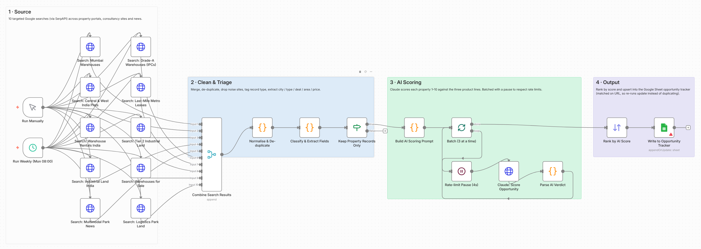
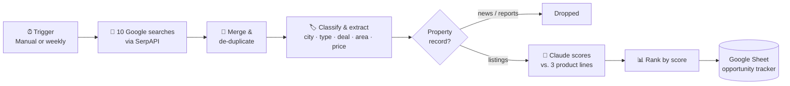

# 🏗️ Logistics Real-Estate Market Intelligence Agent

**An AI agent that finds, screens and ranks land and warehouse opportunities across India, turning hours of manual portal-browsing into a ranked deal pipeline in a Google Sheet.**

`n8n` · `Claude API (Haiku 4.5)` · `SerpAPI` · `Google Sheets` · `JavaScript` · `Prompt engineering`



---

## 1. The business problem

A logistics real-estate developer grows by acquiring the right land or buildings before competitors do. In practice, the **land-acquisition / business-development team** spends hours every week:

- browsing property portals (99acres, MagicBricks, NoBroker…) city by city,
- reading consultancy reports and news for new logistics parks and corridors,
- copying listings into spreadsheets, and
- judging which ones are worth a site visit.

This is **slow, inconsistent and easy to miss**. Two analysts will screen the same listing differently, duplicates pile up, and good sites get lost in the noise.

The developer in this project has **three product lines**, and every site must fit at least one:

| Product line | What it is | Ideal site |
|---|---|---|
| **Multimodal Park** | Large rail/road-connected logistics parks | 50+ acres near freight corridors |
| **Regional Warehouse** | Grade-A warehouses in Tier 2 & 3 cities | Industrial land near highways in growing regional hubs |
| **Urban Last-Mile** | Small fulfilment hubs inside metros | Compact warehouses close to consumers |

## 2. What this agent does

It automates the **top of the deal-sourcing funnel**: from "what's on the market?" to "which 5 sites should we look at first?"

| Manual process (before) | With the agent (after) |
|---|---|
| Analyst searches portals city by city | 10 targeted searches run in parallel, on demand or every Monday |
| Copy-paste into Excel | Listings land in a Google Sheet automatically |
| Duplicates and spam sites everywhere | De-duplicated; noise sites (directories, social posts) filtered out |
| Subjective "looks good" judgement | Every site scored **1–10** against the three product lines by the same rubric |
| No record of *why* a site was picked | Each row has a **strategic note**, **key risk** and **recommended action** |

**Output:** a ranked opportunity tracker. Each property gets a score, the product it fits, a deal-fit rating, and a recommended action: **Pursue / Shortlist / Monitor / Skip**.

## 3. How it works



| Stage | What happens | Why it matters for the business |
|---|---|---|
| **1. Source** | 10 searches covering metro warehouses, Tier 2 industrial land, logistics-park land, consultancy (IPC) listings and infrastructure news | Wide market coverage in one run |
| **2. Clean & triage** | Removes duplicate URLs and noise sites. Tags each result as *listing*, *portal page* or *market intel*. Uses regex to pull out city, property type, rent vs sale, area and price | Turns messy search results into structured data |
| **3. AI scoring** | Claude acts as an investment analyst and returns strict JSON: score, product fit, deal fit, action, strategic note and risk. Runs in batches of 3 with a 4-second pause | A consistent, explainable screening rubric that respects API rate limits |
| **4. Output** | Sorts by score and upserts into Google Sheets, matching rows on URL | The team opens one sheet with the best sites at the top. Re-runs update rows instead of duplicating them |

### Sample output

See [`sample_output/sample_scored_opportunities.csv`](sample_output/sample_scored_opportunities.csv). These are *illustrative* rows showing the format.

| City | Property | AI Score | Product Fit | Action | Strategic note |
|---|---|---|---|---|---|
| Indore | 12-acre industrial plot | 9 | Regional Warehouse | Pursue | Large plot in Tier 2 manufacturing cluster with highway access |
| Mumbai | 45,000 sq ft Grade-A warehouse | 8 | Urban Last-Mile | Pursue | Proven logistics hub serving Mumbai consumption |
| Coimbatore | 1.2-acre commercial plot | 3 | None | Skip | Zoning and size don't fit any product |

## 4. Design decisions

- **Rules first, AI second.** Cheap regex and domain rules remove noise *before* any paid API call. That cuts cost and gives the model cleaner input.
- **Structured LLM output.** The prompt fixes allowed values for each field. The parser pulls out the JSON, caps the score at 10, and falls back to `Skip` if the reply is malformed. A bad response can never break the run.
- **Idempotent writes.** Rows are upserted on URL, so the sheet becomes a living tracker rather than a pile of duplicates.
- **Cost-aware.** Uses Claude Haiku, a fast and low-cost model, with a short prompt and a small token budget per property.

## 5. Run it yourself

**You need:** an n8n account (cloud trial or free self-hosted via `npx n8n`), a [SerpAPI](https://serpapi.com) key, an [Anthropic API](https://console.anthropic.com) key, and a Google account.

1. In n8n: **Workflows → Import from File** → choose `workflow/logistics_market_intelligence_agent.json`.
2. Create credentials: **SerpAPI**, **Anthropic** and **Google Sheets OAuth2**. Select them on the nodes that show a warning.
3. Create a Google Sheet with this header row:
   `Date, Title, City, Property Type, Deal Type, Area, Price, AI Score, Product Fit, Deal Fit, Action, Strategic Note, Risk, Record Type, Source, URL, Snippet, Query Used`
4. In **Write to Opportunity Tracker**, replace `PASTE_YOUR_GOOGLE_SHEET_ID_HERE` with your sheet's ID. The ID is the long code in the sheet's URL.
5. Click **Execute workflow**.

**Offline test (no API keys needed):** `node tests/validate_workflow.js` checks the workflow structure and runs every code node on mock data.

## 6. Limitations & roadmap

- Search snippets are short, so price and area are often missing. **Next:** fetch the full listing page for high-scoring sites.
- Market-intel articles are currently dropped. **Next:** send them to a second sheet as a weekly market brief.
- City detection is rule-based. **Next:** add geocoding and distance to highways, rail freight terminals and ports.
- **Next:** email or Slack alerts when a site scores 8 or higher.

## 7. Repository structure

```
logistics-market-intelligence-agent/
├── README.md
├── workflow/logistics_market_intelligence_agent.json   # import into n8n
├── tests/validate_workflow.js                          # offline structural + logic tests
├── sample_output/sample_scored_opportunities.csv       # illustrative output
└── assets/workflow-canvas.png                          # workflow screenshot
```

---
*Built by [Keshav Vatsa](https://www.linkedin.com/in/keshav-vatsa-420a7a257) · MSc Business Analytics & AI, Warwick Business School.*
